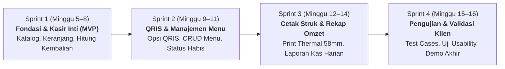

# Product Backlog — Sistem Kasir Warung Makan (KasirWarung)

Dokumen ini memuat daftar kebutuhan produk yang terkelola (*Product Backlog*), rencana alokasi *Sprint*, dan rincian pemecahan tugas teknis untuk pengembangan **Sistem Kasir Warung Makan**, disusun berdasarkan pedoman **Jobsheet 4 & Praktikum Rekayasa Perangkat Lunak**.

---

## 1. Konsep & Tata Kelola Backlog

1. **Prinsip Agile / Scrum Sederhana:**
   - Pengembangan dibagi ke dalam **4 siklus Sprint** (durasi 2 minggu per Sprint) hingga batas akhir praktikum pada Minggu 16.
   - Seluruh butir backlog diturunkan langsung dari Kebutuhan Fungsional (KF) di [SRS Ringkas](../srs/srs.md) dan fitur [PRD](../../PRD.md). Dilarang memasukkan tugas yang tidak memiliki dasar kebutuhan (*no orphan tasks*).
2. **Kriteria Beban Tugas (Workload Granularity):**
   - Setiap tugas kecil pada *Sprint Backlog* dirancang memiliki estimasi penyelesaian **maksimal 1 hari kerja** (2–4 jam kerja efektif) agar progres dapat ditinjau harian tanpa hambatan besar.

---

## 2. Rencana Alokasi Sprint (Sprint Roadmap)

---

## 3. Tabel Product Backlog Terprioritas (MoSCoW)

| No | ID Kebutuhan | Butir Backlog (User Story / Fitur) | Prioritas | Estimasi | Sprint Tentatif |
| :-: | :---: | :--- | :---: | :---: | :---: |
| 1 | **KF-01** | Menampilkan katalog menu dan kategori (Makanan, Minuman, Lauk, Ekstra) di antarmuka kasir. | **Must** | 3 SP | **Sprint 1** |
| 2 | **KF-03** | Memilih tipe pesanan pelanggan: *Makan di Tempat (Dine-in + No Meja)* atau *Bungkus (Take-away)*. | **Must** | 2 SP | **Sprint 1** |
| 3 | **KF-04** | Keranjang pesanan kasir dinamis: penambahan item, pengaturan *qty*, dan kalkulasi subtotal/total otomatis. | **Must** | 4 SP | **Sprint 1** |
| 4 | **KF-05** | Validasi ketersediaan menu: sistem memblokir penambahan menu berstatus *Habis* ke keranjang. | **Must** | 2 SP | **Sprint 1** |
| 5 | **KF-06** | Perhitungan uang kembalian secara otomatis saat kasir menginput nominal pembayaran uang tunai. | **Must** | 2 SP | **Sprint 1** |
| 6 | **KF-07** | Validasi transaksi tunai: menolak konfirmasi jika nominal bayar kurang dari total belanja. | **Must** | 2 SP | **Sprint 1** |
| 7 | **KF-09** | Pembuatan nomor transaksi unik berformat tanggal dan urutan (`TRX-YYYYMMDD-XXX`) serta penyimpanan transaksi. | **Must** | 3 SP | **Sprint 1** |
| 8 | **KF-08** | Integrasi opsi metode pembayaran nontunai menggunakan kode QRIS statis warung makan. | **Must** | 3 SP | **Sprint 2** |
| 9 | **KF-02** | Modul manajemen data menu oleh pemilik: tambah menu, edit nama, ubah harga, dan toggle status *Tersedia/Habis*. | **Must** | 5 SP | **Sprint 2** |
| 10 | **KNF-06** | Validasi input sisi server: sanitasi harga dan jumlah uang tunai untuk mencegah angka negatif dan celah SQLi/XSS. | **Must** | 3 SP | **Sprint 2** |
| 11 | **KF-10** | Tampilan nota struk digital dan fasilitas cetak struk format printer thermal 58mm/80mm via `@media print`. | **Should** | 3 SP | **Sprint 3** |
| 12 | **KF-11** | Riwayat transaksi penjualan harian tanggal berjalan beserta rincian item yang dibeli. | **Should** | 3 SP | **Sprint 3** |
| 13 | **KF-12** | Laporan rekapitulasi omzet harian: pemisahan total pendapatan kas Tunai fisik vs saldo QRIS. | **Must** | 4 SP | **Sprint 3** |
| 14 | **KF-13** | Ringkasan peringkat 5 menu terlaris (*Top 5 Best Seller*) berdasarkan kuantitas porsi terjual. | **Should** | 2 SP | **Sprint 3** |
| 15 | **KNF-01 s.d. KNF-05** | Pengujian menyeluruh (*Test Cases* Minggu 13), evaluasi respon $\le 2\text{ detik}$, dan penyesuaian font $\ge 16\text{ px}$. | **Must** | 5 SP | **Sprint 4** |

---

## 4. Pemecahan Tugas Detail Sprint 1 (Sprint 1 Backlog Breakdown)

Sesuai aturan Jobsheet 4: satu tugas teknis maksimal 1 hari kerja (2–4 jam kerja):

| Task ID | ID Kebutuhan | Uraian Tugas Teknis | Estimasi | Penanggung Jawab | Status |
| :---: | :---: | :--- | :---: | :---: | :---: |
| **T-1.1** | Setup | Inisiasi arsitektur Flask, konfigurasi virtual environment, `requirements.txt`, dan struktur folder modular. | 0.5 Hari | Tim Pengembang | Siap Dikerjakan |
| **T-1.2** | Setup | Merancang skema basis data SQLite (`kategori`, `menu`, `transaksi`, `transaksi_detail`) dan skrip data awal (*seed data* lauk warung). | 1 Hari | Tim Pengembang | Siap Dikerjakan |
| **T-1.3** | KF-01 | Membuat antarmuka HTML/CSS antarmuka kasir (*Point of Sales*) dengan grid tombol menu berbasis kategori. | 1 Hari | Tim Pengembang | Siap Dikerjakan |
| **T-1.4** | KF-03 | Menambahkan komponen pemilihan tipe pesanan (*Dine-in* + input No Meja atau *Take-away*) pada form kasir. | 0.5 Hari | Tim Pengembang | Siap Dikerjakan |
| **T-1.5** | KF-04, KF-05 | Mengimplementasikan logika keranjang pesanan (tambah item, ubah kuantitas, hitung subtotal otomatis, dan blokir menu habis). | 1 Hari | Tim Pengembang | Siap Dikerjakan |
| **T-1.6** | KF-06, KF-07 | Mengimplementasikan modal pembayaran tunai: input uang diterima, kalkulasi kembalian instan, dan penolakan jika uang kurang. | 1 Hari | Tim Pengembang | Siap Dikerjakan |
| **T-1.7** | KF-09 | Membuat rute backend `/transaksi/simpan` untuk mencatat transaksi ke database dan menghasilkan nomor nota unik. | 1 Hari | Tim Pengembang | Siap Dikerjakan |
| **T-1.8** | DoD | Melakukan pengujian alur pesanan dari awal hingga selesai (*happy path* dan *edge cases* uang kurang) di localhost. | 0.5 Hari | Tim Pengembang | Siap Dikerjakan |

---

## 5. Kriteria Selesai Butir Backlog (Definition of Done)

Setiap butir backlog dinyatakan selesai (*Done*) jika:
1. Memenuhi kriteria penerimaan fungsional (*Given–When–Then*) yang ditetapkan di PRD.
2. Lolos uji coba lokal tanpa galat (*zero runtime error*).
3. Kode lolos peninjauan (*peer review*) melalui Pull Request dengan templat PR terisi lengkap.
4. Perubahan digabungkan (*merged*) ke branch `main`.
