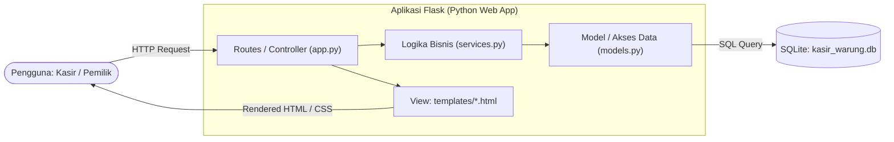
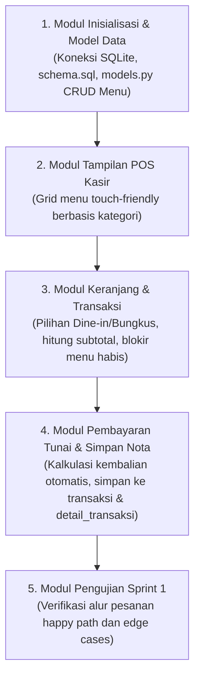

# Arsitektur Aplikasi dan Struktur Folder — KasirWarung
## Langkah 12 Sesi 2: Perancangan Arsitektur Aplikasi Web Berlapis (Jobsheet 6)

Dokumen ini memuat perancangan arsitektur aplikasi web berlapis (*Layered Architecture - MVC Pattern*), pembagian tanggung jawab berkas (*Separation of Concerns*), serta urutan implementasi modul Sprint 1 untuk proyek **Sistem Kasir Warung Makan (*KasirWarung*)**.

---

## 1. Diagram Arsitektur Aplikasi Berlapis (Mermaid)

Arsitektur aplikasi memisahkan alur permintaan pengguna menjadi empat lapisan independen:



---

## 2. Struktur Folder Repositori

Struktur folder proyek ditata secara modular agar pengembangan dan integrasi kode berjalan teratur:

```text
rpl-kasir-warung-makan/
├── app.py                  # Routes / Controller (menerima HTTP request, memilih view)
├── services.py             # Logika bisnis (kalkulasi kembalian, validasi menu habis)
├── models.py               # Model & akses basis data (satu-satunya berkas yang bicara ke SQLite)
├── templates/              # View (templat antarmuka HTML Jinja2)
│   ├── base.html           # Tata letak dasar (header, navbar, footer)
│   ├── kasir.html          # Antarmuka POS kasir (grid menu & keranjang belanja)
│   ├── menu.html           # Manajemen daftar menu & harga
│   ├── struk.html          # Format tampilan & dialog cetak struk thermal
│   └── laporan.html        # Rekapitulasi omzet dan menu terlaris
├── static/                 # Aset statis
│   ├── css/
│   │   ├── style.css       # Gaya visual touch-friendly
│   │   └── print.css       # Format khusus cetak kertas thermal 58mm (@media print)
│   └── js/
│       └── pos.js          # Interaksi dinamis keranjang belanja kasir
├── tests/                  # Pengujian kode & basis data
│   └── cek_skema.py        # Pengujian integritas skema SQLite
├── docs/                   # Dokumentasi rekayasa perangkat lunak
│   ├── backlog/            # Product Backlog & rencana Sprint
│   ├── desain/             # Luaran Jobsheet 6 (ERD, kamus data, normalisasi, schema.sql, arsitektur)
│   ├── elisitasi/          # Catatan wawancara, pedoman, & user story
│   ├── kesepakatan-tim/    # Piagam kerja sama tim & matriks RACI
│   ├── srs/                # Spesifikasi Kebutuhan Perangkat Lunak (SRS)
│   └── uml/                # Pemodelan UML (Use Case & Activity Diagram)
├── .github/
│   └── pull_request_template.md
├── .gitignore
├── aturan-proyek.md        # Aturan teknis dan konvensi proyek
├── PRD.md                  # Dokumen Kebutuhan Produk
├── README.md               # Ringkasan utama proyek
└── requirements.txt        # Dependensi Python (Flask, dll.)
```

---

## 3. Pembagian Tanggung Jawab Lapisan (Separation of Concerns)

Sesuai aturan baku Lampiran D.3 Jobsheet 6:

| Berkas / Lapisan | Tanggung Jawab Utama | Boleh Dilakukan | **Dilarang Keras** |
| :--- | :--- | :--- | :--- |
| **`app.py`**<br>*(Controller / Routes)* | Menangani rute URL HTTP (`GET`, `POST`), menangkap input form, memanggil fungsi logika di `services.py`, dan me-render template HTML. | Menerima request HTTP, validasi parameter dasar URL, memilih template view (`render_template`). | **Dilarang menulis query SQL langsung** (SELECT, INSERT, UPDATE, DELETE). |
| **`services.py`**<br>*(Logika Bisnis)* | Mengatur aturan bisnis kasir: menghitung subtotal/total belanja, menghitung kembalian uang, memvalidasi menu habis, dan memformat rekap omzet harian. | Menjalankan kalkulasi matematis, aturan bisnis warung makan, memanggil `models.py`. | **Dilarang membuat kode HTML** atau berinteraksi langsung dengan sqlite3. |
| **`models.py`**<br>*(Model / Akses Data)* | **Satu-satunya lapisan** yang berinteraksi dengan basis data `kasir_warung.db` via kueri berparameter (*parameterized query*). | Menulis kueri SQL, mengelola koneksi SQLite, mengeksekusi transaksi data. | **Dilarang berisi logika bisnis** atau formatting tampilan HTML. |
| **`templates/*.html`**<br>*(View)* | Menampilkan antarmuka pengguna berbasis Jinja2 ke layar peramban. | Menampilkan variabel data, perulangan daftar menu/item nota, penataan layout visual. | **Dilarang memproses logika bisnis** kompleks. |

---

## 4. Urutan Implementasi Modul untuk Sprint 1

Berdasarkan prioritas Kebutuhan Fungsional (KF) di Product Backlog, urutan pengerjaan fitur pada Sprint 1 adalah sebagai berikut:


