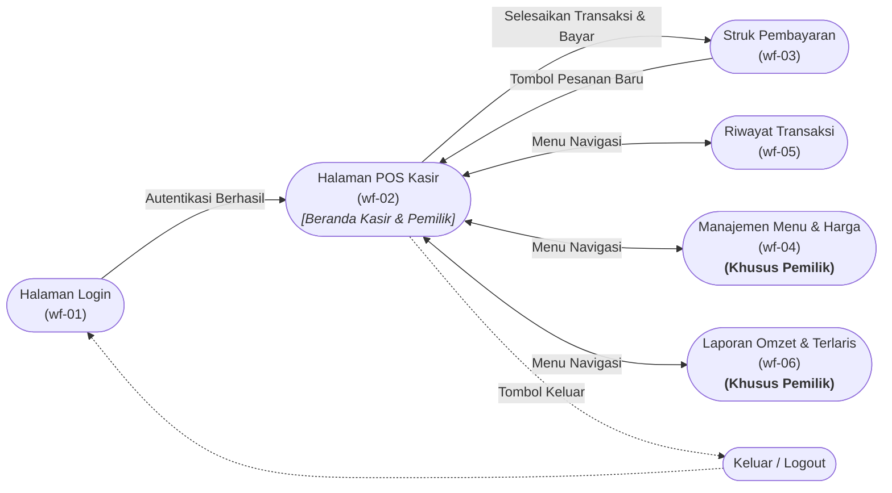

# Peta Navigasi Aplikasi — Kasir Warung Makan (KasirWarung)
## Langkah 3 Sesi 1: Perancangan Peta Navigasi Antarmuka (Jobsheet 7)

Dokumen ini memuat peta navigasi perpindahan halaman aplikasi kasir warung makan yang dirancang menggunakan sintaks Mermaid `flowchart LR` sesuai format Lampiran A.1 Jobsheet 7.

---

## 1. Kode Sumber Diagram Mermaid ([`navigasi.mmd`](navigasi.mmd))

---

## 2. Analisis Keterpenuhan Aturan Peta Navigasi (Langkah 3)

1. **Cakupan Seluruh Halaman Langkah 2:**
   - Seluruh 6 halaman utama dari Langkah 2 (`wf-01` s.d. `wf-06`) muncul sebagai simpul dalam diagram alur navigasi.
2. **Penandaan Hak Akses Peran (*Role-Based Access*):**
   - Halaman **Manajemen Menu (`wf-04`)** dan **Laporan Omzet (`wf-06`)** ditandai tegas dengan label **(Khusus Pemilik)**. Kasir yang bertugas tidak dapat melihat tombol menu ini pada navbar aplikasi.
3. **Penerapan Aturan "Maksimal 2 Klik":**
   - Dari Halaman Beranda / Kasir POS (`wf-02`), setiap halaman fungsional dapat dicapai hanya dalam **1 kali klik** melalui bilah navigasi atas (*top navbar*).
4. **Pencegahan Halaman Yatim (*No Orphan Pages*):**
   - Tidak ada halaman buntu. Setiap halaman tujuan memiliki tombol kembali (*back navigation*) ke halaman utama POS kasir:
     - Dari `wf-03` (Struk) $\rightarrow$ ada tombol *"Pesanan Baru"* untuk kembali ke kasir.
     - Dari `wf-04`, `wf-05`, dan `wf-06` $\rightarrow$ ada tautan navbar *"Kasir / POS"* untuk kembali ke alur transaksi.
     - Dari mana saja $\rightarrow$ tombol *"Keluar"* membersihkan sesi dan kembali ke halaman login (`wf-01`).
