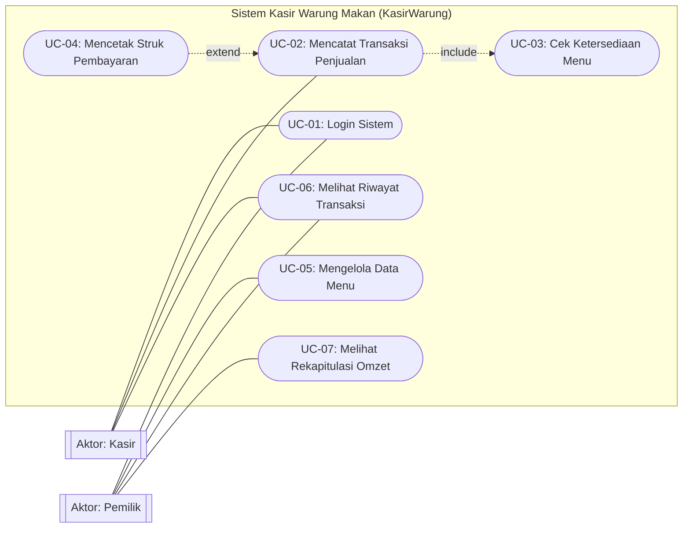
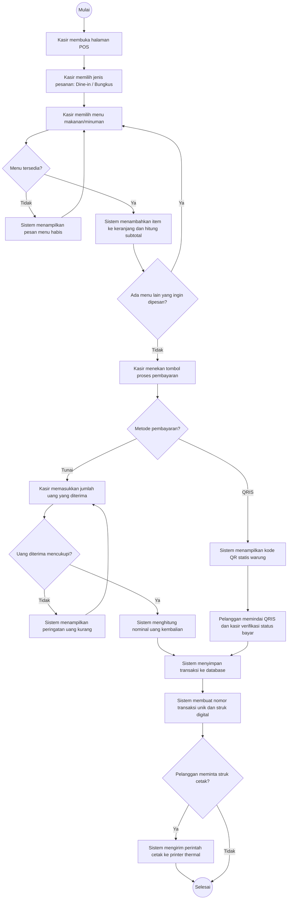
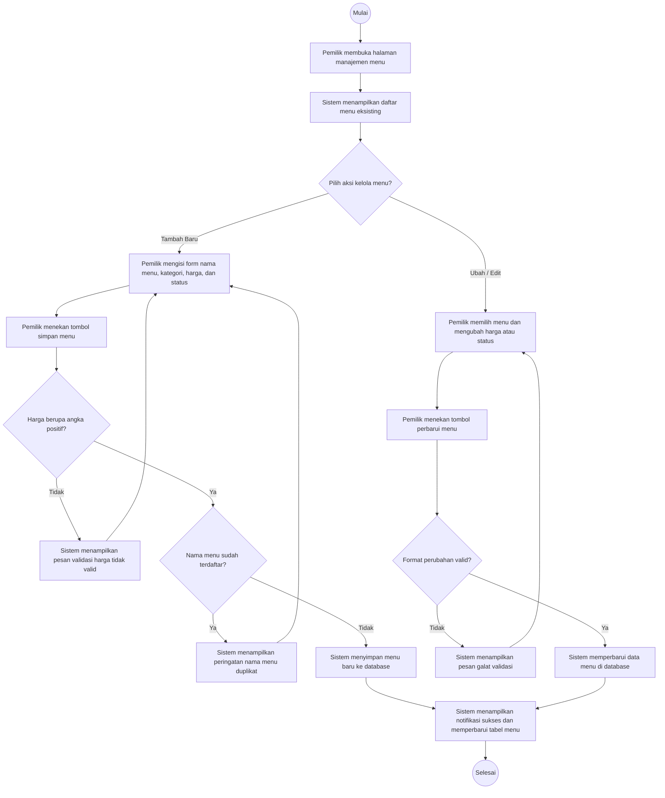
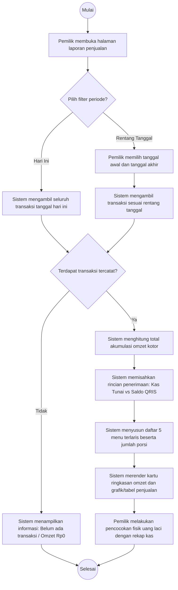

# Pemodelan Sistem dengan UML (KasirWarung)

Folder ini berisi artefak pemodelan sistem perangkat lunak untuk **Sistem Kasir Warung Makan (*KasirWarung*)**, disusun berdasarkan acuan **Jobsheet 5 Praktikum Rekayasa Perangkat Lunak**.

---

## 📋 Daftar Isi Berkas
1. [`use-case.mmd`](use-case.mmd) : Kode sumber Mermaid Use Case Diagram sistem kasir warung makan.
2. [`skenario-use-case.md`](skenario-use-case.md) : Dokumen skenario detail 6 *use case* (alur utama, alternatif, dan pengecualian).
3. [`activity-01-transaksi-penjualan.mmd`](activity-01-transaksi-penjualan.mmd) : Activity Diagram proses pencatatan penjualan kasir & pembayaran.
4. [`activity-02-kelola-menu.mmd`](activity-02-kelola-menu.mmd) : Activity Diagram proses tambah & pembaruan menu makanan/minuman.
5. [`activity-03-rekap-omzet.mmd`](activity-03-rekap-omzet.mmd) : Activity Diagram proses penutupan kas & rekapitulasi omzet harian.

---

## 1. Identifikasi Aktor (Langkah 2 Jobsheet 5)

| No | Aktor | Deskripsi Peran | Sumber (PRD/SRS) |
| :-: | :--- | :--- | :--- |
| 1 | **Kasir** | Petugas operasional yang melayani pesanan pembeli di meja kasir, memilih menu pesanan, menerima pembayaran (Tunai/QRIS), menghitung uang kembalian, dan mencetak struk nota. | PRD Bagian 3, FR-03 s.d. FR-08 |
| 2 | **Pemilik** | Pengelola usaha yang mengatur daftar menu beserta harga, mengontrol ketersediaan menu lauk harian, serta memantau laporan omzet dan rekap kas harian. | PRD Bagian 3, FR-01, FR-02, FR-10, FR-11 |

---

## 2. Tabel Pemetaan Use Case (Langkah 3 Jobsheet 5)

| ID | Nama Use Case | Aktor | Kebutuhan Terkait (KF) | Prioritas |
| :-: | :--- | :--- | :--- | :-: |
| **UC-01** | Login Sistem | Kasir, Pemilik | FR-01, NFR-Security | Must |
| **UC-02** | Mencatat Transaksi Penjualan | Kasir | FR-03, FR-04, FR-05, FR-06, FR-07, FR-12 | Must |
| **UC-03** | Cek Ketersediaan Menu | Kasir | FR-01, FR-02 (via include UC-02) | Must |
| **UC-04** | Mencetak Struk Pembayaran | Kasir | FR-08 (via extend UC-02) | Must |
| **UC-05** | Mengelola Data Menu | Pemilik | FR-01, FR-02 | Must |
| **UC-06** | Melihat Riwayat Transaksi | Kasir, Pemilik | FR-09 | Should |
| **UC-07** | Melihat Rekapitulasi Omzet | Pemilik | FR-10, FR-11 | Must |

---

## 3. Visualisasi Diagram

### A. Use Case Diagram

---

### B. Activity Diagram 1: Pencatatan Transaksi Penjualan

---

### C. Activity Diagram 2: Pengelolaan Data Menu

---

### D. Activity Diagram 3: Rekapitulasi Omzet Harian

---

## 4. Daftar Periksa Verifikasi (Lampiran C Jobsheet 5)

| No | Pertanyaan Periksa | Hasil Evaluasi |
| :-: | :--- | :--- |
| 1 | Semua aktor di diagram ada di PRD? Adakah aktor tambahan? | **Lolos.** Aktor hanya `Kasir` dan `Pemilik`, tanpa aktor fiktif. |
| 2 | Setiap use case tertelusur ke minimal satu KF? | **Lolos.** Seluruh UC terhubung ke FR-01 s.d. FR-12 di PRD. |
| 3 | Adakah use case tambahan yang tidak ada di PRD? | **Lolos.** Tidak ada fitur liar/halusinasi seperti pemindai barcode atau e-commerce kurir. |
| 4 | Notasi benar: aktor di luar batas sistem, include/extend tepat? | **Lolos.** Aktor di luar kotak subgraph. Relasi `include` untuk validasi menu, `extend` untuk cetak struk fisik opsional. |
| 5 | Activity diagram memiliki satu awal dan minimal satu akhir? | **Lolos.** Seluruh activity diagram diawali 1 simpul `Mulai` dan berakhir di `Selesai`. |
| 6 | Setiap keputusan memiliki semua cabang berlabel (Ya/Tidak)? | **Lolos.** Seluruh simpul keputusan `{}` memiliki cabang berlabel jelas. |
| 7 | Pengecualian pada skenario (misal uang kurang/menu habis) muncul di diagram? | **Lolos.** Kondisi gagal tercakup dengan alur kembali (*loop-back*) ke perbaikan input. |
| 8 | Tidak ada aktivitas buntu atau perulangan tanpa jalan keluar? | **Lolos.** Seluruh jalur memiliki titik keluar yang terdefinisi. |
